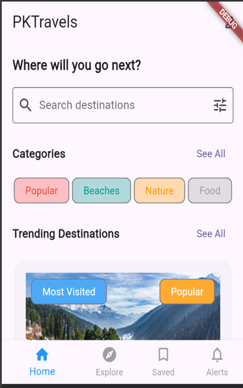
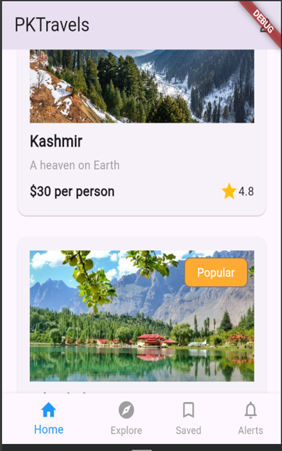
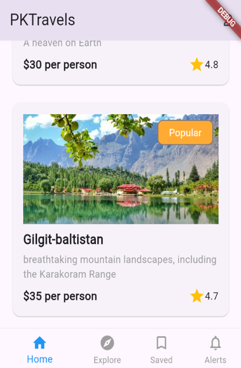
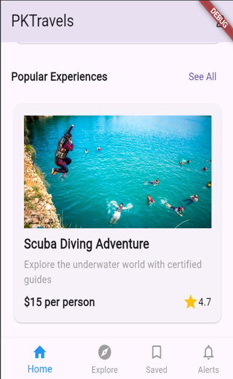

# 🇵🇰 PKTravels - Mobile App

<div align="center">

  <br/><br/>

  [](https://flutter.dev)
  [](https://dart.dev)
  [](#platforms-supported)
  [](#license)
  [](https://github.com/t-kiran-05/PAKTravels-Mobile-App/pulls)

  <p align="center">
    <b>A modern, cross-platform Flutter mobile application designed to inspire travelers and showcase the breathtaking landscapes, rich culture, and thrilling adventures of Pakistan.</b>
  </p>

  <p align="center">
    <a href="#-app-screenshots">Screenshots</a> •
    <a href="#-key-features">Key Features</a> •
    <a href="#-tech-stack">Tech Stack</a> •
    <a href="#-getting-started">Getting Started</a> •
    <a href="#-project-structure">Project Structure</a> •
    <a href="#-roadmap">Roadmap</a>
  </p>

</div>

---

## 📱 App Screenshots

<div align="center">
  <table>
    <tr>
      <td align="center" width="25%">
        <b>Home & Search</b><br/>
        
      </td>
      <td align="center" width="25%">
        <b>Trending Destinations</b><br/>
        
      </td>
      <td align="center" width="25%">
        <b>Mountain Tours</b><br/>
        
      </td>
      <td align="center" width="25%">
        <b>Adventure Experiences</b><br/>
        
      </td>
    </tr>
  </table>
</div>

---

## ✨ Key Features

- 🔍 **Interactive Destination Search & Filter**
  - Instant search bar with filter toggle to explore destinations and experiences easily.

- 🏷️ **Categorized Exploration**
  - Quick category filtering chips including **Popular**, **Beaches**, **Nature**, and **Food**.

- 🏔️ **Trending Destinations Showcase**
  - Rich cards showcasing iconic locations like **Kashmir** and **Gilgit-Baltistan**.
  - Highlights pricing per person, star ratings, and status badges (*"Most Visited"*, *"Popular"*).

- 🤿 **Curated Adventures & Activities**
  - Featured adventure cards highlighting activities such as **Scuba Diving Adventures** with transparent pricing and review scores.

- 📖 **Dedicated Tour Detail View (`DetailPage`)**
  - Full-screen imagery with tour highlights (*Guided Tour*, *Scenic Spots*, *Hotel Pickup*, *Meals Included*).
  - Interactive favorites bookmarking with instant feedback.
  - Social sharing trigger and direct **"Book Now"** action.

- 🧭 **Bottom Navigation Bar**
  - Intuitive navigation tabs: **Home**, **Explore**, **Saved**, and **Alerts**.

---

## 🛠️ Tech Stack

| Component | Technology | Description |
| :--- | :--- | :--- |
| **Framework** | [Flutter](https://flutter.dev) (v3.x) | Cross-platform UI toolkit |
| **Language** | [Dart](https://dart.dev) (>=3.4.3 <4.0.0) | Client-optimized language |
| **Design System** | Material Design | Clean cards, custom chips, and modern typography |
| **Icons** | Material Icons & Cupertino Icons | Vector icons for intuitive UX |
| **Asset Management** | Flutter Asset Bundle | Curated, high-resolution regional destination photography |
| **Networking** | CachedNetworkImage | Efficient network image loading & local caching support |

---

## 📂 Project Structure

```text
PAKTravels-Mobile-App/
├── android/                 # Android native project and Gradle files
├── assets/                  # High-resolution image assets
│   ├── adventure.png
│   ├── budget.png
│   ├── culture.jpg
│   ├── destination.jpg
│   ├── favorites.jpg
│   ├── gb.jpg
│   ├── kashmir.jpg
│   ├── scuba.jpg
│   └── tips.jpg
├── ios/                     # iOS native Xcode project configuration
├── lib/                     # Application source code
│   ├── DetailPage.dart      # Interactive tour & destination details screen
│   └── main.dart            # App entrypoint and Home exploration page
├── screenshots/             # In-app UI screenshots
│   ├── t1.png
│   ├── t2.png
│   ├── t3.png
│   └── t4.png
├── test/                    # Unit and widget tests
│   └── widget_test.dart
├── web/                     # Web platform runner and configuration
├── pubspec.yaml             # Flutter project dependencies and assets definition
└── README.md                # Project documentation
```

---

## 🚀 Getting Started

Follow these steps to run the application locally on your machine.

### Prerequisites

Ensure you have the following installed on your system:
- **[Flutter SDK](https://docs.flutter.dev/get-started/install)** (Version 3.4.3 or newer)
- **Dart SDK** (Bundled with Flutter)
- **[Android Studio](https://developer.android.com/studio)** / **[VS Code](https://code.visualstudio.com/)** with Flutter extensions
- Android Emulator, iOS Simulator, or a connected physical device

Verify your Flutter environment by running:
```bash
flutter doctor
```

### Installation & Run

1. **Clone the repository:**
   ```bash
   git clone https://github.com/t-kiran-05/PAKTravels-Mobile-App.git
   cd PAKTravels-Mobile-App
   ```

2. **Install project dependencies:**
   ```bash
   flutter pub get
   ```

3. **Run the app:**
   ```bash
   flutter run
   ```

---

## 📦 Building for Production

### Android (APK & App Bundle)

Generate an optimized release APK:
```bash
flutter build apk --release
```
*The output APK will be located at `build/app/outputs/flutter-apk/app-release.apk`.*

Generate an Android App Bundle (AAB) for Google Play Store:
```bash
flutter build appbundle --release
```

### Web
```bash
flutter build web --release
```

---

## 🗺️ Roadmap & Future Enhancements

- [ ] **Interactive Maps & Geolocation**: Integration with Google Maps / Mapbox to show exact locations.
- [ ] **Authentication & Profiles**: User sign-in with Google and custom email.
- [ ] **Saved Favorites Storage**: Local persistent bookmarking using Hive or SharedPreferences.
- [ ] **Booking & Payment Gateway**: Integration with Stripe / local Pakistani payment gateways (Easypaisa, JazzCash).
- [ ] **Dark Mode Support**: Full adaptive theme support for nighttime exploration.

---

## 🤝 Contributing

Contributions are what make the open-source community such an amazing place to learn, inspire, and create. Any contributions you make are **greatly appreciated**!

1. Fork the Project
2. Create your Feature Branch (`git checkout -b feature/AmazingFeature`)
3. Commit your Changes (`git commit -m 'Add some AmazingFeature'`)
4. Push to the Branch (`git push origin feature/AmazingFeature`)
5. Open a Pull Request

---

## 📄 License

Distributed under the **MIT License**. See `LICENSE` for more information.

---

## 👤 Author

**T. Kiran**
- GitHub: [@t-kiran-05](https://github.com/t-kiran-05)
- Repository: [PAKTravels-Mobile-App](https://github.com/t-kiran-05/PAKTravels-Mobile-App)

<div align="center">
  <sub>Built with ❤️ using Flutter for exploring Pakistan.</sub>
</div>
